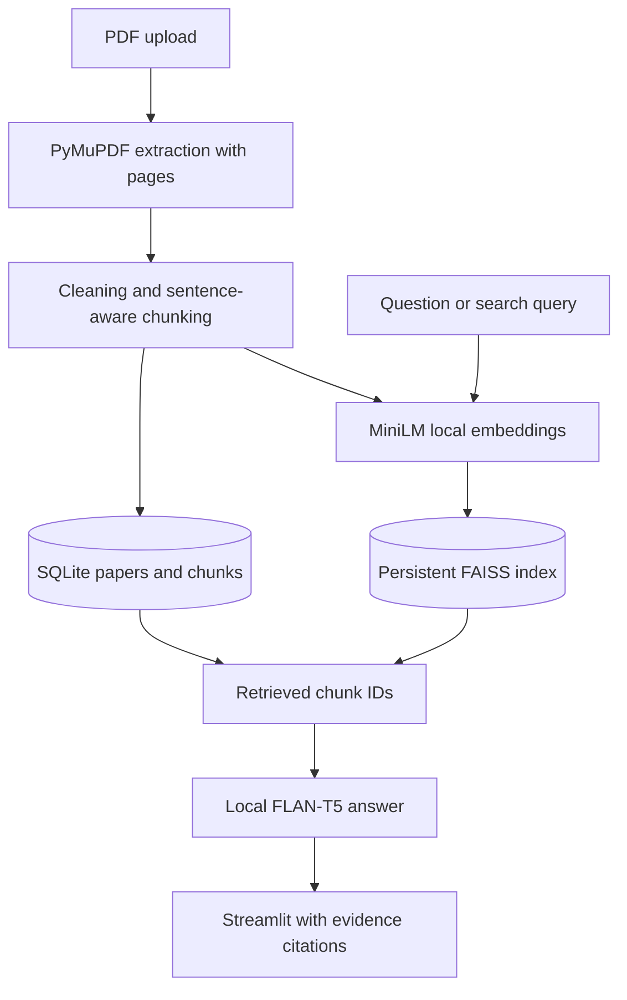

# ResearchLens

ResearchLens is a local, CPU-first research paper analyzer for Windows 11. It extracts selectable text from PDFs, stores paper and page metadata in SQLite, embeds chunks locally, searches those vectors with FAISS, and exposes analysis tools through Streamlit. Document contents are not sent to a hosted inference API.

## Problem and objectives

Research papers are long and difficult to search across. ResearchLens helps a student build a small private paper collection, find relevant passages, inspect evidence with page references, and compare what the uploaded sources say. It demonstrates practical NLP: document parsing, text normalization, chunking, TF-IDF, transformer embeddings, vector retrieval, and retrieval-augmented generation (RAG).

## Features

- Multiple PDF upload, SHA-256 duplicate detection, file checks, safe names, and paper deletion.
- PyMuPDF selectable-text extraction with page numbers, best-effort title, abstract, year, and page count.
- Sentence-aware approximate token chunks with stable page links and overlap.
- SQLite storage for papers, chunks, summaries, keywords, searches, and analysis history.
- Persistent FAISS inner-product search over normalized 384-dimensional MiniLM embeddings.
- Semantic search and evidence-grounded question answering with paper/page evidence cards.
- Local summarization, TF-IDF keywords, structured comparison, collection-level research opportunities, and related-paper discovery.
- Streamlit dashboard with collection statistics and backend/model status.
- Lazy CPU model loading, cached weights, and a clear unverified NPU status.

Some PDF title and abstract parsing is heuristic, and section detection uses heading patterns rather than a scholarly document parser. This first version does not provide OCR or author extraction. When a requested section is not detected, its summary is generated from the available full text and labeled accordingly. If the local summarizer or generator is unavailable, summary and answer paths use a clearly limited extractive fallback; semantic retrieval still requires the embedding model. Gap suggestions are hypotheses about the uploaded collection and require external literature review.

## Direct-open browser chat

Open `index.html` directly to use the lightweight browser-only chat without starting Streamlit or opening a localhost URL. Add PDF papers and ask questions; it ranks text passages in the browser and displays the source filename and page number. This version uses extractive passage retrieval and does not generate answers with a Transformer model. Its PDF reader library is loaded from cdnjs on first open, so PDF upload needs internet access for that library. Extracted paper text and chat history are saved in the browser's IndexedDB and restored after refresh, in the same browser profile and from the same local file location. The original PDF file bytes are not saved. Plain-text uploads work without the PDF reader. Clearing browser site data removes the saved collection.

## Architecture



### Main modules

| Area | Files | Responsibility |
| --- | --- | --- |
| Configuration | `config.py` | Data locations, models, limits, and backend selection |
| Persistence | `database/db.py`, `database/schema.sql` | SQLite schema, parameterized CRUD, cascading deletion |
| PDF and text | `preprocessing/` | PDF extraction, cleanup, sentence-aware chunking |
| Models | `models/` | Lazy model loading and CPU inference |
| Retrieval | `retrieval/` | Persistent FAISS, semantic search, evidence-grounded RAG |
| Analysis | `nlp/`, `research/` | TF-IDF terms, summaries, comparison, gaps, related papers |
| Hardware | `hardware/` | CPU status and conservative optional NPU reporting |
| UI | `app.py` | Dashboard and seven task pages |

## NLP concepts

- **Text extraction** reads selectable characters and layout text from PDF pages. It is not OCR; image-only scans are rejected with an explanation.
- **Preprocessing** normalizes whitespace, removes soft hyphens, repairs line-wrapped words, and segments sentences.
- **Tokenization** divides text into units. Chunk sizing uses an approximate word/punctuation count, while the embedding model applies its own tokenizer.
- **Chunking** groups nearby sentences into about 500 approximate tokens with around 100 tokens of overlap. Each chunk stores its paper and starting page. A chunk spanning pages is assigned its first source page in this version.
- **Embeddings** map a text passage into a vector. `sentence-transformers/all-MiniLM-L6-v2` produces 384 values that place semantically similar passages near one another.
- **Semantic search** embeds the query and ranks passages by cosine similarity. The vectors are normalized, so FAISS inner product is cosine similarity.
- **Vector database** (here, a persistent FAISS index) quickly searches dense vectors. SQLite remains the source of truth for the chunk-ID mapping and document metadata.
- **RAG** retrieves paper passages, puts them in a bounded prompt, and asks a local generation model to answer from those excerpts. The UI displays the actual retrieved text and metadata for checking. Similarity or citation labels do not guarantee factual correctness.
- **Transformer generation** uses a pretrained sequence-to-sequence model to produce text conditioned on the prompt; local model weights are needed for offline inference.

## Models and resource use

Default models:

- Embedding: `sentence-transformers/all-MiniLM-L6-v2` (384 dimensions).
- Summarization: `sshleifer/distilbart-cnn-6-6`.
- Generation: `google/flan-t5-small`.

Models are loaded lazily and model-family switches clear the previous model cache to reduce simultaneous RAM use. The `8 GB RAM` target uses CPU inference and small batches, but transformer performance depends on the paper size and available memory. A first model use downloads weights from Hugging Face; later use can be offline if packages and all required weights are already installed/cached. Set `HF_HUB_OFFLINE=1` to disallow model downloads. The app never silently sends content to a cloud model.

## Database and index

Tables: `papers`, `paper_chunks`, `summaries`, `keywords`, `search_history`, and `analysis_history`. Foreign keys cascade from a paper to its records. Files are saved in `data/uploads/`; SQLite is in `data/researchlens.sqlite3`; FAISS files are in `data/indexes/`. The index and its chunk-ID mapping are saved together. Deletion compacts the flat FAISS index and removes the paper's database records and uploaded PDF.

## Windows 11 installation

Python 3.11 is the recommended baseline. Newer Python versions may work if compatible PyTorch and FAISS wheels are available. The included environment was Python 3.13.5. Install in PowerShell without administrator privileges:

```powershell
cd "C:\Users\BHARATH\Downloads\Reserach paper analyser"
py -3.11 -m venv .venv
.\.venv\Scripts\Activate.ps1
python -m pip install --upgrade pip
pip install -r requirements.txt
```

If PowerShell blocks activation, use `Set-ExecutionPolicy -Scope Process Bypass` in that PowerShell window, then activate again. This only changes policy for the current process. No Docker, CUDA, API key, or AMD runtime is required.

## Run and use

```powershell
.\.venv\Scripts\Activate.ps1
$env:INFERENCE_DEVICE = "cpu"
streamlit run app.py
```

Streamlit opens the local app in a browser. Begin with **Upload papers**; the first indexing run downloads the embedding model. Then use **Semantic search**, **Research assistant**, **Paper analyzer**, **Paper comparison**, or **Research gaps**. Delete/reprocess controls are on the upload page. Default maximum size is 50 MB per PDF; set `MAX_UPLOAD_MB` to change it.

For a double-click Windows startup, open `start_researchlens.bat`. It creates `.venv` if needed, installs the requirements into it if missing, and starts Streamlit. Keep its console window open while using the app. Open `index.html` after the server is running to go directly to the chat. Browser security does not allow an HTML file to start a local Python server by itself; the batch launcher is the one-time/startup step.

To start explicitly offline after models were cached:

```powershell
$env:HF_HUB_OFFLINE = "1"
$env:INFERENCE_DEVICE = "cpu"
streamlit run app.py
```

## Tests

```powershell
python -m pytest -q
```

Tests use generated tiny PDFs, a temporary SQLite database, and small random vectors. They do not download Transformer model weights. They cover PDF errors/extraction, page mapping, text cleanup/chunking, duplicate constraint and cascade behavior, FAISS persistence/deletion, and insufficient-evidence handling.

## CPU and AMD NPU status

`INFERENCE_DEVICE=cpu` selects the guaranteed CPU path. `auto` currently selects CPU as well. The app does not claim NPU use based on hardware detection. `INFERENCE_DEVICE=npu` fails with a direct explanation because an AMD Ryzen AI execution provider, compatible ONNX export, and verified end-to-end inference are not configured here. The local ONNX Runtime reports `AzureExecutionProvider` and `CPUExecutionProvider`; it reports no Ryzen AI/Vitis AI provider. Windows Plug and Play device enumeration was blocked by the restricted environment, so the installed driver/device state could not be independently inspected. NPU support should only be added after checking the specific Windows runtime, provider availability, model conversion/operator support, and confirming inference executes on the NPU.

To verify CPU mode, open **Settings** and check “Active backend: cpu”; model wrappers explicitly instantiate CPU pipelines and Sentence-Transformers with `device="cpu"`. To verify future NPU support, require a reported AMD provider plus a model inference session configured with that provider and measured/runtime-reported provider execution. Hardware presence alone is not sufficient.

## Limitations and future work

- OCR, robust scholarly metadata extraction, section segmentation, and multi-page citation ranges are not included.
- Chunk size is approximate and based on word/punctuation count rather than the embedding tokenizer.
- RAG confidence uses a conservative similarity cutoff; answers still need human evidence review.
- Comparison and gap discovery use transparent keyword/evidence heuristics; they do not prove novelty, causal claims, or exhaustive field coverage.
- No automated index repair command exists yet; reprocess papers with a failed embedding status.
- Future work: OCR integration, GROBID-style metadata/section parsing, richer per-field citation rendering, index integrity checks/rebuild UI, user-tunable thresholds, and verified AMD Ryzen AI ONNX Runtime support when compatible software is available.
